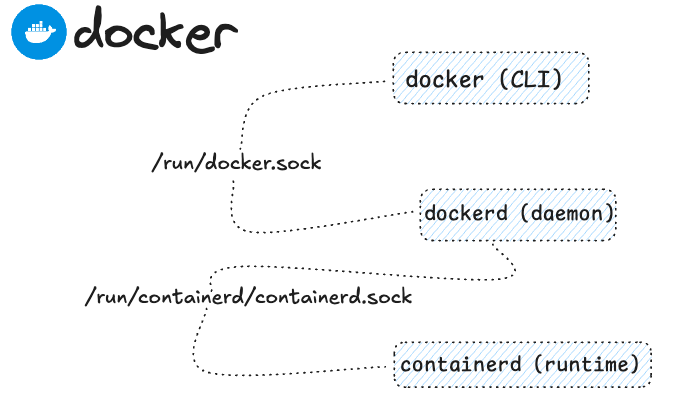

### Setup

Docker engine ubuntu setup:

* Try to use docker CLI `docker ps`{{exec}}, check the for docker services: `systemctl list-units --type=service --all`
, inspect the unit file `systemctl cat docker.service` as systemd sees it. If needed query systemd journal: `journalctl -xeu docker.service`{{exec}}. 

* Actually docker.service manages the a **dockerd** process (ExecStart to spawn the process)

* Check images on the machine `docker image ls` start a container based on `dejanualex/dockersay:2.0`{{copy}} image, next use `curl` and leverage unix domain socket `--unix-socket` to **list images**: `curl --unix-socket /var/run/docker.sock http://localhost/images/json`{{copy}}

Hint

Check the status of <code>docker.socket</code> and use systemctl to start the unit <code>systemctl start docker.socket</code> 

