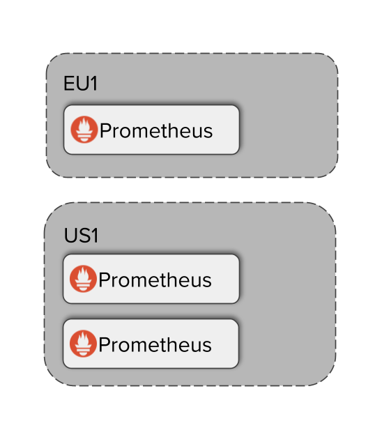

## Prometheus setup

We have the following Prometheus setup: 1 Prometheus server in some `eu1` cluster and 2 Prometheus servers in `us1` cluster. Let's spin up those Prometheus servers.




* Create the data directories for Prometheus servers: `mkdir -p prometheus0_eu1_data prometheus0_us1_data prometheus1_us1_data`{{copy}}

* Create configuration for EU Prometheus server, `prometheus0_eu1.yml`:

```yaml
global:
  scrape_interval: 15s
  evaluation_interval: 15s
  external_labels:
    cluster: eu1
    replica: 0

scrape_configs:
  - job_name: 'prometheus'
    static_configs:
      - targets: ['172.17.0.1:9090']
```{{copy}}  

* Create configuration for US Prometheus server (first replica), `prometheus0_us1.yml`:

```yaml
global:
  scrape_interval: 15s
  evaluation_interval: 15s
  external_labels:
    cluster: us1
    replica: 0

scrape_configs:
  - job_name: 'prometheus'
    static_configs:
      - targets: ['172.17.0.1:9091','172.17.0.1:9092']
```{{copy}}

* Create configuration for US Prometheus server (second replica), `prometheus1_us1.yml`:

```yaml
global:
  scrape_interval: 15s
  evaluation_interval: 15s
  external_labels:
    cluster: us1
    replica: 1

scrape_configs:
  - job_name: 'prometheus'
    static_configs:
      - targets: ['172.17.0.1:9091','172.17.0.1:9092']
```{{copy}}

External labels are used to identify the Prometheus server, are used by Thanos Querier to deduplicate metrics from multiple Prometheus servers and are also used to identify the source of the metrics in Thanos Querier.

## Starting Prometheus Instances

Let's now start the 3 containers representing our three different Prometheus instances.  Note the extra flags we're passing to Prometheus:

* `--web.enable-admin-api` allows Thanos Sidecar to get metadata from Prometheus like `external labels`.
* `--web.enable-lifecycle` allows Thanos Sidecar to reload Prometheus configuration and rule files if used.

### Deploying "EU1"

```
docker run -d --net=host --rm \
    -v $(pwd)/prometheus0_eu1.yml:/etc/prometheus/prometheus.yml \
    -v $(pwd)/prometheus0_eu1_data:/prometheus \
    -u root \
    --name prometheus-0-eu1 \
    quay.io/prometheus/prometheus:v3.13.5 \
    --config.file=/etc/prometheus/prometheus.yml \
    --storage.tsdb.path=/prometheus \
    --web.listen-address=:9090 \
    --web.external-url={{TRAFFIC_HOST1_9090}} \
    --web.enable-lifecycle \
    --web.enable-admin-api && echo "Prometheus EU1 started!"
```{{execute}}


### Deploying "US1"

```
docker run -d --net=host --rm \
    -v $(pwd)/prometheus0_us1.yml:/etc/prometheus/prometheus.yml \
    -v $(pwd)/prometheus0_us1_data:/prometheus \
    -u root \
    --name prometheus-0-us1 \
    quay.io/prometheus/prometheus:v3.13.5 \
    --config.file=/etc/prometheus/prometheus.yml \
    --storage.tsdb.path=/prometheus \
    --web.listen-address=:9091 \
    --web.external-url={{TRAFFIC_HOST1_9091}} \
    --web.enable-lifecycle \
    --web.enable-admin-api && echo "Prometheus 0 US1 started!"
```{{execute}}

and

```
docker run -d --net=host --rm \
    -v $(pwd)/prometheus1_us1.yml:/etc/prometheus/prometheus.yml \
    -v $(pwd)/prometheus1_us1_data:/prometheus \
    -u root \
    --name prometheus-1-us1 \
    quay.io/prometheus/prometheus:v3.13.5 \
    --config.file=/etc/prometheus/prometheus.yml \
    --storage.tsdb.path=/prometheus \
    --web.listen-address=:9092 \
    --web.external-url={{TRAFFIC_HOST1_9092}} \
    --web.enable-lifecycle \
    --web.enable-admin-api && echo "Prometheus 1 US1 started!"
```{{execute}}